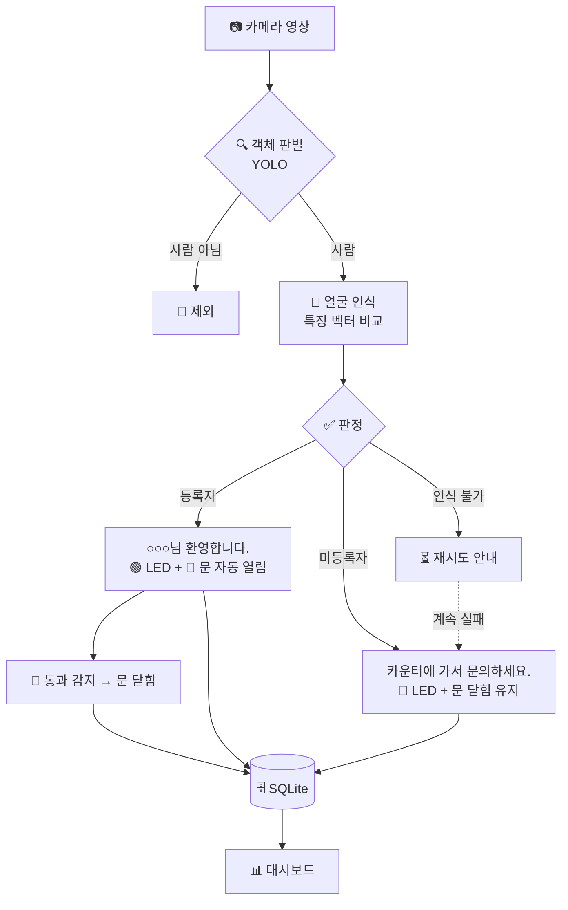

# 🏢 방문자 확인 시스템

> 얼굴 인식으로 **등록자는 자동 출입**, **미등록자는 카운터로 안내**하는 기업 방문자 확인 시스템

개발자 : **김동진, 김성민, 정재열**

---

## 📌 프로젝트 소개

회사 출입구에서 방문자를 확인하는 과정을 카메라, 영상처리, 아두이노로 자동화합니다.

- 🙋 **등록자**: 환영 메시지와 함께 모형 출입문이 자동으로 열립니다.
- ❓ **미등록자**: "카운터에 가서 문의하세요."를 안내하고, 문은 닫힌 채로 둡니다.
- 🚪 결과는 **3색 LED**와 **서보모터 모형 문**에 반영하고, 방문 기록은 **SQLite**에 저장해 **대시보드**에서 조회합니다.

> 💻 노트북 카메라로 출입구 상황을 가정해 개발·시연하며, 사전학습 모델을 활용한 **추론 중심**으로 구성합니다.

---

## ✨ 주요 기능

| 번호 | 기능 | 설명 | 상태 |
|:---:|---|---|:---:|
| F1 | 🔍 객체 판별 | YOLO로 사람인지 판별, 사람일 때만 다음 단계 진행 | 🛠️ 개발 예정 |
| F2 | 🙂 얼굴 인식 | 얼굴 특징 벡터를 추출해 등록된 얼굴과 비교 | 🛠️ 개발 예정 |
| F3 | ✅ 판정·안내 | 등록자 / 미등록자 / 인식 불가 판정, 화면 안내 | 🛠️ 개발 예정 |
| F4 | 🚪 출입문 제어 | 아두이노로 LED, 모형 문 열고 닫기, 통과 감지 | 🛠️ 개발 예정 |
| F5 | 🗄️ 방문 기록 저장 | 방문 기록과 문 동작을 SQLite에 저장 | 🛠️ 개발 예정 |
| F6 | 📊 대시보드 | 방문 기록 조회·통계 | 🛠️ 개발 예정 |
| F7 | 🧾 카운터 승인 화면 | 카운터 직원이 미등록자를 승인하면 문이 열림 | 🔹 선택 |
| F8 | 📦 택배 감지 | 상자가 일정 시간 놓여 있으면 기록 | 🔹 선택 |

### 💬 상황별 동작

| 상황 | 화면 안내 | LED | 출입문 |
|---|---|:---:|---|
| 등록자 | **"○○○님 환영합니다."** | 🟢 | 자동 열림 |
| 미등록자 | **"카운터에 가서 문의하세요."** | 🔴 | 닫힘 유지 |
| 인식 불가 | "얼굴이 보이도록 카메라를 바라봐 주세요." *(예시)* | 🟡 | 닫힘 |

---

## 🔄 처리 흐름

- 🗳️ **다수결 판정**: 여러 프레임의 결과를 모아 판정해 오인식을 줄입니다.
- ⏱️ **쿨다운**: 같은 사람에게는 일정 시간 동안 안내와 기록을 반복하지 않습니다.
- 🖥️ **화면 배치**: 노트북 화면은 방문자 안내용으로 쓰고, 대시보드는 휴대폰처럼 다른 기기의 브라우저로 봅니다.

---

## 🛠️ 기술 스택

| 영역 | 기술 |
|---|---|
| 언어 | Python, C++ (Arduino) |
| 영상 처리 | OpenCV |
| 객체 판별 | Ultralytics YOLO (yolov8n) |
| 얼굴 인식 | face_recognition / InsightFace / OpenCV YuNet + SFace *(선정 예정)* |
| 한글 안내 화면 | Pillow |
| DB | SQLite |
| 대시보드 | Flask |
| PC–아두이노 통신 | pyserial |

---

## 🔌 하드웨어

| 부품 | 용도 |
|---|---|
| Arduino UNO R3 호환보드 | 노트북 명령 수신, 모터·LED 제어 |
| MG90S 서보모터 | 모형 문 작동 |
| 3색 신호등 LED 모듈 | 상태 표시 |
| 적외선 장애물 감지 센서 | 문 통과 감지 |
| 5V 3A 어댑터 + DC 터미널 | 서보 별도 전원 |
| 점퍼 케이블, 폼보드 | 배선, 모형 제작 |

| 아두이노 핀 | 연결 |
|---|---|
| D9 | 서보모터 신호선 |
| D2 | 적외선 센서 |
| D4~D6 | 3색 LED |
| 외부 5V | 서보 전원 (GND는 아두이노와 공통 연결) |

---

## 🗄️ DB 구조

| 테이블 | 내용 |
|---|---|
| `persons` | 등록자 이름, 대표 사진 경로, 등록 시각 |
| `face_embeddings` | 등록자별 얼굴 특징 벡터 (1인당 3~5개) |
| `visits` | 방문 시각, 구분, 이름, 얼굴 거리, 안내 문구, 사진 경로, 통과 시각 |
| `door_events` | 문 열림·닫힘·통과 기록 |

---

## 👥 역할 분담

| 역할 | 담당 | 한 줄 요약 |
|---|---|---|
| 🙂 **얼굴 인식** | 정재열 | 얼굴을 인식해서 등록자인지 판정 |
| 🔗 **영상 흐름·화면·연결** | 김성민 | 카메라·YOLO부터 안내 화면, 아두이노 명령, 대시보드까지 전체 흐름 연결 |
| 🔌 **아두이노·DB** | 김동진 | 모형 문과 회로, DB와 SQL 함수 |

---

## 📅 개발 일정 (6주)

| 주차 | 목표 |
|:---:|---|
| 1주 | 개발 환경, YOLO 사람 판별, 얼굴 인식 라이브러리 선정, 부품 주문, DB 테이블 |
| 2주 | 얼굴 특징 비교·등록, 한글 안내 화면, 아두이노 기본 동작, SQL 함수 |
| 3주 | 판정 기준값·다수결, 대시보드 기본 틀, 폼보드 모형 제작 |
| 4주 | 전체 연결 → 🎯 **최소 완성본** (등록자 자동 출입 + 미등록자 안내·기록) |
| 5주 | 기록 조회·통계 화면, 인식 성능 조정, (선택) 카운터 승인 화면·택배 감지 |
| 6주 | 통합 점검, 시연 세팅, 🚀 보고서·발표 |

---

## 🔒 개인정보 보호

- 🧑‍🤝‍🧑 시연에는 **동의한 팀원 얼굴만** 등록합니다.
- 💾 얼굴 사진과 특징 벡터는 외부로 전송하지 않고 **로컬에만** 저장합니다.
- 🚪 출입문은 **시연용 모형**이며 실제 보안 장치가 아닙니다.

